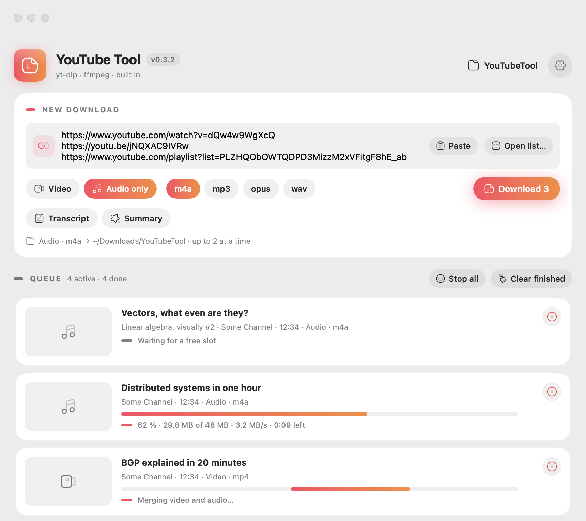
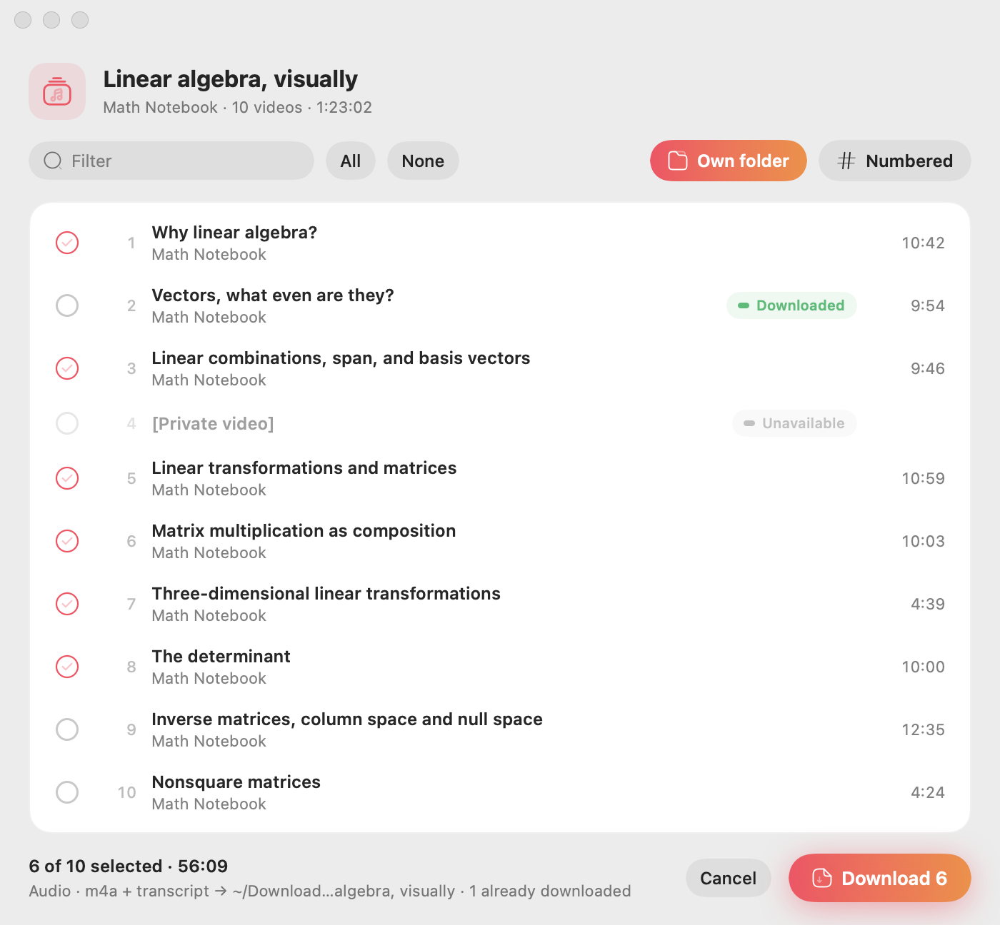

# YouTube Tool

[](https://github.com/mkrajinov/youtube-tool/releases/latest)
[](LICENSE)


A native macOS app that downloads YouTube videos as mp4, or audio only as m4a, mp3, opus
or wav, and can save a transcript and an on-device summary next to each one. yt-dlp,
FFmpeg and Deno are built in, so nothing else needs installing.

```sh
brew install --cask mkrajinov/tap/youtube-tool
```

<picture>
  <source media="(prefers-color-scheme: dark)" srcset="docs/screenshots/main-dark.png">
  
</picture>

<picture>
  <source media="(prefers-color-scheme: dark)" srcset="docs/screenshots/playlist-dark.png">
  
</picture>

Meant for videos you're allowed to save: your own uploads, Creative Commons and
public-domain material, or offline viewing where YouTube's terms permit it.

Several at once:

- Paste or drop any number of links (one per line), or open a text file with links
  (**Open list…**). Every YouTube link in the text is picked up, and they download 2 at a time
  (up to 4, in Settings).
- Playlist and channel links open a list of their videos to pick from, with options to save
  into a folder named after the playlist and to number the files in playlist order. Videos
  already in the folder are left unticked, so re-running a playlist only fetches new ones.
- A video link opened from a playlist (`&list=…`) downloads just that video and offers the
  rest of the playlist.

It can also save a **transcript** and a **summary** next to each download:

- Transcripts come from the video's YouTube captions (uploaded or automatic, in the spoken
  language). Videos without captions are transcribed on your Mac with Apple's speech
  recognition (macOS 26 or later).
- Summaries are written on your Mac by Apple Intelligence (macOS 26 or later, Apple
  Intelligence turned on). Nothing is sent to an online service.

Requires macOS 15 or later on Apple Silicon.

## Install with Homebrew

```sh
brew install --cask mkrajinov/tap/youtube-tool
```

Update with `brew upgrade --cask youtube-tool`. Remove with
`brew uninstall --cask youtube-tool`; add `--zap` to also delete settings and the
updatable yt-dlp copy.

Downloads are saved to `~/Downloads/YouTubeTool` (changeable in Settings). If downloads
start failing because YouTube changed something, use Settings → Tools → Update to fetch
the latest yt-dlp.

## Build from source

Needs Xcode 16 or later.

```sh
./scripts/build-app.sh      # fetches the pinned tools, builds YouTubeTool.app
open YouTubeTool.app
swift test                  # unit tests; YTT_LIVE=1 adds real download tests
```

## Release

Every push to `main` is released automatically by the **Build and release** GitHub Action:

1. It picks the version: `VERSION` if that hasn't been released yet, otherwise the next patch
   (0.3.0 → 0.3.1 → 0.3.2 …). Bump `VERSION` by hand to start a new minor or major version.
2. It runs the tests, builds `YouTubeTool-<version>.zip` and the cask `youtube-tool.rb`, and
   publishes both as GitHub release `v<version>` (the tag is created on the pushed commit).
3. With the `HOMEBREW_TAP_TOKEN` secret (fine-grained token limited to
   [mkrajinov/homebrew-tap](https://github.com/mkrajinov/homebrew-tap), Contents
   read/write) it updates `Casks/youtube-tool.rb` there, so `brew upgrade` picks it up.

With the signing secrets set (`DEVELOPER_ID_P12`, `DEVELOPER_ID_P12_PASSWORD`, `NOTARY_KEY_P8`,
`NOTARY_KEY_ID`, `NOTARY_ISSUER`; see the workflow file) the app is signed with a Developer ID
and notarized, so it opens without a Gatekeeper warning. Without them it is ad-hoc signed and
the cask removes the quarantine flag.

Running the action by hand from the Actions tab re-releases the current `main`. Locally,
`./scripts/release.sh` produces the same files in `dist/`; with `SIGN_IDENTITY` and
`NOTARY_PROFILE` set it signs with a Developer ID and notarizes (see the script header).

## License

MIT, see [LICENSE](LICENSE). The bundled yt-dlp, FFmpeg (GPL-3.0) and Deno keep their own
licenses, listed in [THIRD_PARTY_NOTICES.md](THIRD_PARTY_NOTICES.md).

## Third-party software

See [THIRD_PARTY_NOTICES.md](THIRD_PARTY_NOTICES.md). FFmpeg is GPLv3.
